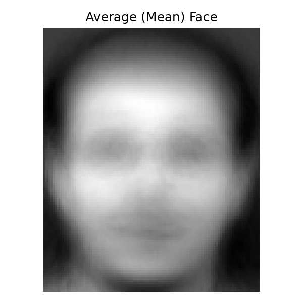
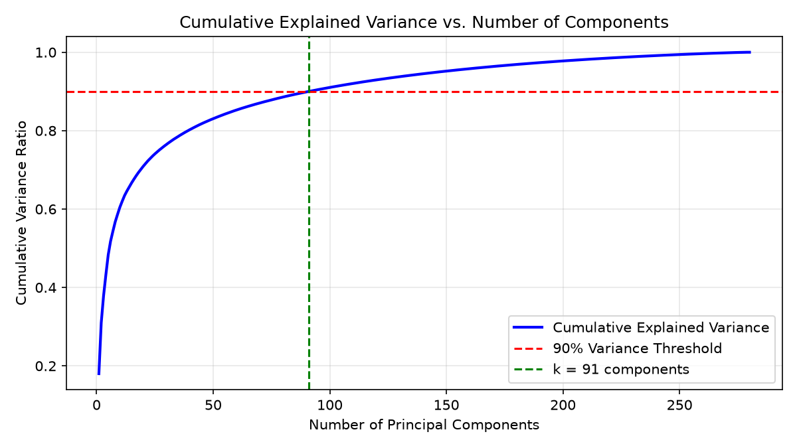
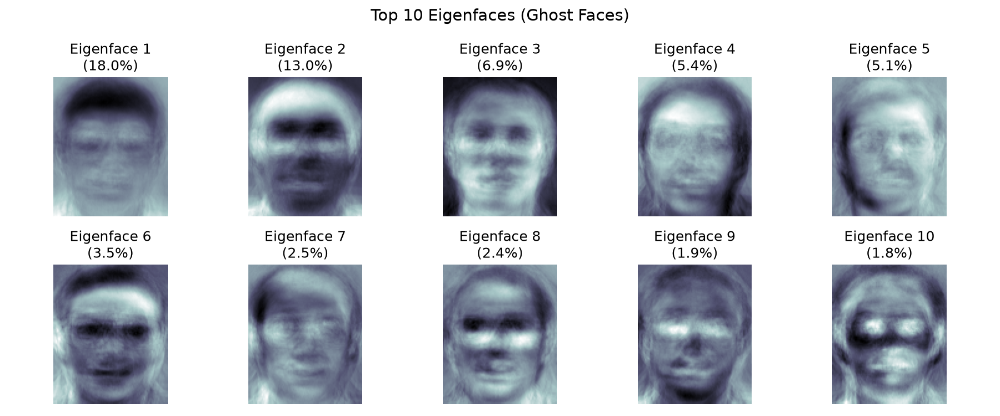
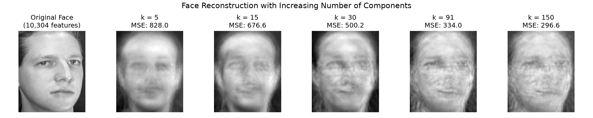
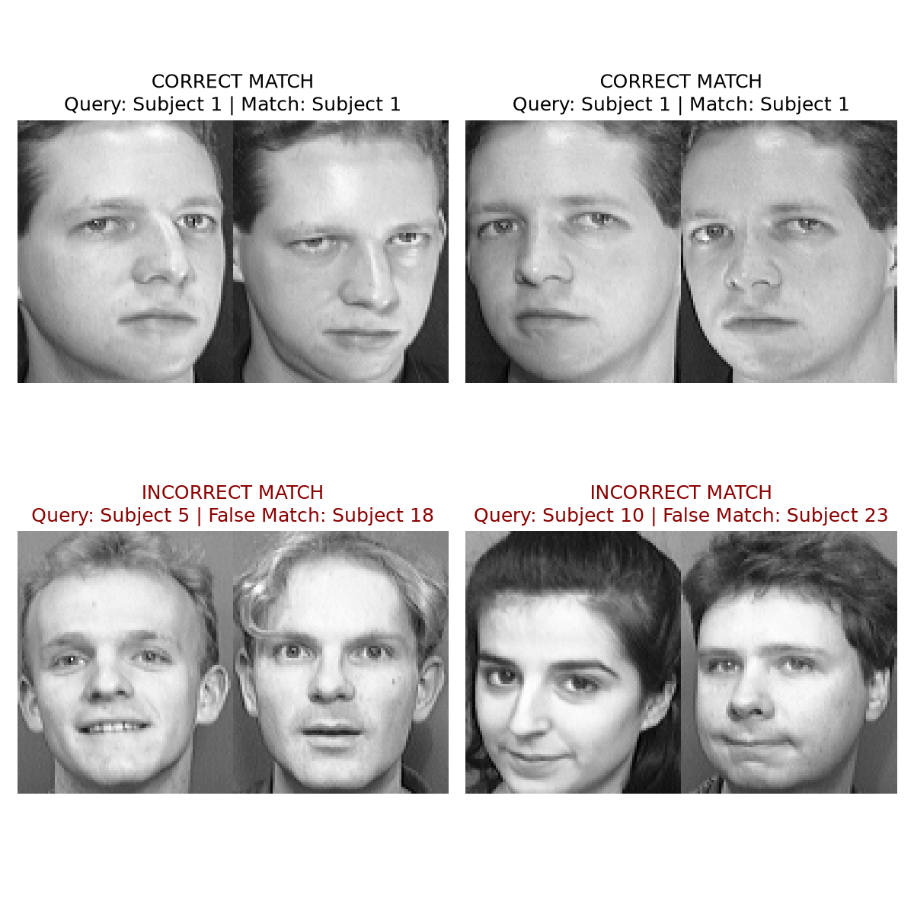
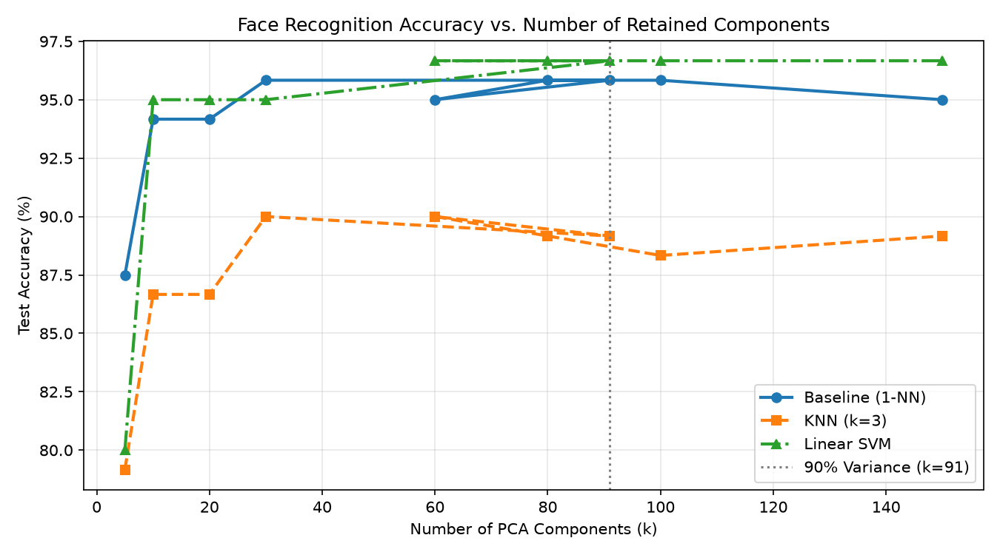

# DS605: Fundamentals of Machine Learning — Lab Assignment 7
## Image Representation, PCA, Eigenfaces and Face Recognition

**Student Roll No:** 202618062  
**Dataset:** AT&T Database of Faces (ORL Database)  
**Submission:** Public GitHub Repository  

---

## 1. Project Overview & Objective
The goal of this assignment is to explore facial image representation, perform dimensionality reduction using **Principal Component Analysis (PCA)** and **Eigenfaces** implemented entirely using **NumPy linear algebra operations**, and evaluate face recognition performance. 

We compare:
1. Two mathematical formulations of PCA: **Covariance Eigendecomposition** vs. **Singular Value Decomposition (SVD)**.
2. Recognition accuracy and runtime in **reduced PCA space** versus **raw pixel space**.
3. Similarity-based nearest-neighbor matching against traditional machine learning classifiers (**KNN**, **Linear SVM**, **RBF SVM**, and **Logistic Regression**).

---

## 2. Dataset Description & Preprocessing (Part A)
- **Source:** AT&T Database of Faces (40 subjects, 10 images per subject = 400 total grayscale images).
- **Resolution:** $112 \times 92$ pixels per image.
- **Feature Vector:** Each 2D image is flattened into a 1D vector of length $D = 112 \times 92 = 10,304$ features.
- **Intensity Values:** Pixel intensities range from $0.0$ to $251.0$ (8-bit grayscale).
- **Train-Test Split:** A stratified, reproducible 70/30 split (`random_state=42`):
  - **Training Set:** 280 images (7 images per subject across all 40 subjects) $\rightarrow$ Matrix shape: `(280, 10304)`.
  - **Test Set:** 120 images (3 images per subject across all 40 subjects) $\rightarrow$ Matrix shape: `(120, 10304)`.

---

## 3. PCA & Eigenfaces: Theory and Implementation (Part B)

### 3.1 Mean Centering
The mean face vector $\mu \in \mathbb{R}^{10304}$ is computed across the training set:
$$\mu = \frac{1}{N} \sum_{i=1}^{N} x_i$$
Each image is centered by subtracting the mean face:
$$\Phi_i = x_i - \mu \quad \implies \quad \Phi_{train} \in \mathbb{R}^{280 \times 10304}$$

---

### 3.2 Covariance Eigendecomposition vs. SVD
Calculating the full covariance matrix $C = \frac{1}{N} \Phi^T \Phi$ requires a $10,304 \times 10,304$ matrix (~106 million elements), which is computationally prohibitive. Instead, we use two mathematically equivalent approaches:

1. **Turk & Pentland Surrogate Covariance ($N \times N$ trick):**
   We compute $L = \frac{1}{N} \Phi \Phi^T$ of size $280 \times 280$. The eigenvectors $v_i$ of $L$ yield the high-dimensional eigenfaces:
   $$u_i = \frac{\Phi^T v_i}{\|\Phi^T v_i\|}$$

2. **Singular Value Decomposition (SVD):**
   Decomposing $\Phi = U \Sigma V^T$ directly provides the principal directions as the rows of $V^T$, with eigenvalues $\lambda_i = \frac{\sigma_i^2}{N}$.

#### Mathematical Verification:
- **Max absolute difference in eigenvalues:** $2.79 \times 10^{-9}$ (identical up to floating-point precision).
- **Absolute dot product of top 5 eigenvectors:** `[1.0, 1.0, 1.0, 1.0, 1.0]` (perfect directional alignment).

---

### 3.3 Explained Variance & Component Retention
To capture at least **90% of the total facial variance**, we analyze cumulative explained variance:
$$\text{Cumulative Ratio}(k) = \frac{\sum_{i=1}^{k} \lambda_i}{\sum_{j=1}^{N} \lambda_j}$$

- **Components required for $\ge 90\%$ variance:** **$k = 91$** components (out of 10,304 original pixels).
- **Exact cumulative variance preserved:** **90.00%**.

---

### 3.4 Visualizing the Eigenfaces
The top principal components reshaped back to $112 \times 92$ matrices reveal the fundamental facial variations:
- **Eigenfaces 1–3:** Capture global illumination differences (lighting angle, left/right shading) and overall head silhouette.
- **Eigenfaces 4–10:** Capture localized features such as hairline, eye position, forehead width, and glasses.

---

### 3.5 Image Reconstruction & Compression Analysis
Faces were reconstructed from the reduced eigenspace weights using:
$$\hat{x} = \mu + \omega V_k^T \quad \text{where } \omega = \Phi V_k$$

#### Storage & Compression Metrics:
| Metric | Original Representation | Reduced PCA Representation ($k=91$) |
|---|---|---|
| **Number of Features** | 10,304 pixels | 91 component weights |
| **Storage per Face** | ~40.25 KB | ~0.36 KB |
| **Compression Factor** | Baseline (1x) | **113.2x reduction** (**99.12% space saved**) |

---

## 4. Recognition in PCA Space (Part C)

Using nearest-neighbor classification with Euclidean distance ($L_2$ norm):
$$d(\omega_{test}, \omega_{train}) = \|\omega_{test} - \omega_{train}\|_2$$

### Performance Comparison:
| Representation Space | Dimensions | Test Accuracy | Execution Time |
|---|---|---|---|
| **Raw Pixel Space** | 10,304 | 95.00% | 7,518.42 ms |
| **Reduced PCA Space ($k=91$)** | 91 | **95.83%** | **23.86 ms** |

> **Key Takeaway:** PCA achieves a **315.1x speedup** in matching time while slightly **improving recognition accuracy** (+0.83%) due to the filtering of high-frequency noise and slight pixel misalignments.

---

### Inspection of Matches
Out of 120 test images, **115 were correctly identified** and only **5 were misclassified**.

- **Correct Matches:** Robust to smiling, head tilts, and lighting variations.
- **Misclassified Cases:** Occur primarily when test subjects have dramatic expression changes or identical visual artifacts (e.g., dark, thick-rimmed glasses or severe shadowing) that overpower subtle identity cues.

---

## 5. Traditional Machine Learning Comparison (Part D)

Traditional classifiers were trained on the $91$-dimensional PCA feature representations:

| Classifier | Settings / Hyperparameters | Test Accuracy (%) |
|---|---|---|
| **Baseline (Euclidean 1-NN)** | Minimum Euclidean Distance in eigenspace | 95.83% |
| **K-Nearest Neighbors** | $k=3$, Euclidean metric | 89.17% |
| **Support Vector Machine (Linear)** | Linear Kernel, $C=1.0$ | 96.67% |
| **Support Vector Machine (RBF)** | RBF Kernel, $C=10.0$, $\gamma=\text{scale}$ | 96.67% |
| **Logistic Regression** | Multiclass (OVR), max_iter=1000 | **98.33%** |

### Key Observations:
1. **Compact Representation:** Classification accuracy rises sharply between $k=5$ and $k=30$, plateauing around $k \approx 40 - 90$. This demonstrates that the first few dozen eigenfaces encode virtually all identity-discriminating information.
2. **Classifier Superiority:** **Logistic Regression** achieved the highest test accuracy (**98.33%**), closely followed by **Linear SVM** (**96.67%**), showing that the PCA projection produces well-separated linear decision boundaries in eigenspace.

---

##